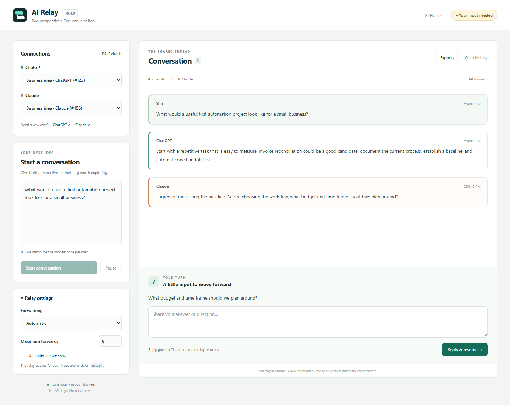

# AI Relay

A local Chrome extension that passes conversations between **ChatGPT** and **Claude** using your existing website sessions. No API keys, relay server, or paid extension service.

**Early testing release.** Tested in signed-in Chrome tabs, but both sites change frequently. Generation completion uses page controls and a text-stability timer, so review important output. Independent of OpenAI and Anthropic.



Dashboard preview with sample conversation content.

## Install in Chrome

1. Download **ai-relay-v0.4.1.zip** from this repository's **Releases** page and extract it to a folder you will keep. Alternatively, choose **Code → Download ZIP** and extract it.
2. Open `chrome://extensions` and turn on **Developer mode**.
3. Choose **Load unpacked** and select the folder containing `manifest.json`.
4. Open [ChatGPT](https://chatgpt.com) and [Claude](https://claude.ai) in separate Chrome tabs. Sign in normally.
5. Refresh both website tabs after installing or updating the extension.
6. Click the **AI Relay** extension icon to open its dashboard.

No Node.js installation or build step is needed to use the extension. This is a local installation, not a Chrome Web Store release. Keep the extracted folder in place.

## Use

1. Click **Refresh tabs**. A single open tab per site is selected automatically; otherwise choose the tabs you want.
2. Choose **Manual approval** for your first test. Automatic relay is the default on new installations.
3. Enter your prompt in the dashboard. Leave AI website composers empty, or containing only the identical unsent prompt you want to retry.
4. Set **Maximum forwards** (1–30), or check **Unlimited — continue until paused**.
5. Click **Start**. ChatGPT receives the prompt first.
6. In manual mode, review each response and click **Forward to other AI**. Automatic mode forwards responses as they finish.

Each model receives the Kelly Hansen / AI Relay introduction **once per provider conversation**, alongside its first message. The extension checks the chat URL and existing setup messages; it does not repeat the introduction on every turn or every new run in the same chat. Opening a new chat gives it a fresh introduction. Claude's first forwarded message includes your original prompt and ChatGPT's response. Later messages carry the next response without repeated setup instructions.

The introduction explains two flags:

- **`#stop#`**: the entire response must match (ignoring surrounding whitespace and capitalization). The discussion ends and history is preserved. A marker quoted inside a longer response does not stop it.
- **`#userInput#`**: the model asks its question, then puts the flag alone on the final line (or replies with only the flag). Forwarding pauses, and the dashboard shows **Your turn** with a reply box. Click **Reply & resume** to send your answer back to the model that asked. The relay continues in its existing mode without resetting its forward count. If sending fails, the question and your answer stay available to retry. Return the AI tab to its original conversation if you navigated away.

Models may not always follow the introduction; **Pause** remains available. Supervise important conversations.

| Control             | Behavior                                                                                       |
| ------------------- | ---------------------------------------------------------------------------------------------- |
| Start               | New run with ChatGPT first. Resets the counter but preserves dashboard history.                |
| Stop / Pause        | Stops forwarding and disarms response capture.                                                 |
| Forward to other AI | Sends a waiting response, including retrying a failed forward.                                 |
| Interject           | Pauses and sends your message to one or both models. Does not automatically resume forwarding. |
| Export Markdown     | Downloads locally stored conversation history.                                                 |
| Reset history       | Clears extension history after confirmation. Does not delete provider chats.                   |

A blank starting prompt arms ChatGPT for its next changed response. Starting again is a new run, not a replay of dashboard history.

## Troubleshooting

- **Cannot connect / older content script:** Reload AI Relay in `chrome://extensions`, refresh both sites and the dashboard, then refresh and reselect tabs. The extension also attempts to attach scripts to already-open supported tabs.
- **Different draft in composer:** Review or save it before clearing. The relay will not overwrite unrelated text.
- **Pasted but not sent:** The relay waits up to 20 seconds for an enabled Send button. Check for ongoing generation, login prompts, site errors, or usage limits. A click is confirmed by the draft clearing; otherwise an error is shown.
- **Forwarding failed:** The response remains available for manual forwarding. Check the destination before retrying to avoid resending an already submitted message.
- **Missing response:** Confirm the relay is running, the correct tab is selected, and generation finished. Site markup may have changed; report which site failed.

Normal service-worker sleep preserves a running relay. Restarting Chrome or updating/reloading the extension pauses it. Keep both website tabs open.

## Privacy and limitations

- History (up to 300 entries), settings, and the original prompt stay in Chrome local extension storage, not Chrome Sync. Export anything you want to keep.
- Forwarding shares text with the destination AI provider. Use content you are comfortable sharing with both providers.
- No extension telemetry, analytics, or backend server. See [PRIVACY.md](PRIVACY.md).
- Capture may include interface labels or thinking text. A pause in streaming can be mistaken for completion. This prototype is not suitable for unattended critical work.
- Website terms, subscriptions, and limits still apply. This extension does not bypass login, rate limits, or anti-bot controls, or provide API access.
- Unlimited removes the extension's forward cap, not provider limits.

## Development

Node.js 22 or newer is needed only for development tooling.

```sh
npm ci
npm run check
npm test
npm run format:check
npm run package
```

`npm run package` prepares an allowlisted extension folder in `dist/ai-relay`. Prettier is a development dependency only; tests use Node's built-in runner. Use `npm run format` to format sources. An optional GitHub Actions template is included at `.github/check-workflow.yml.example`; copy it to `.github/workflows/check.yml` to enable checks and an extension-folder artifact using a login with workflow-upload permission.

Architecture: `dashboard.html` / `dashboard.js` manage controls; `background.js` persists and routes messages; `content.js` and `adapters/` read and operate the websites. Runtime files need no compilation. Reload the extension and both sites after edits.

## Feedback

Open an issue in this repository with the extension version, Chrome version, affected site, exact error, and reproduction steps. Remove private prompt text, credentials, account details, and sensitive screenshots. See [CONTRIBUTING.md](CONTRIBUTING.md).

## License

[MIT](LICENSE).
